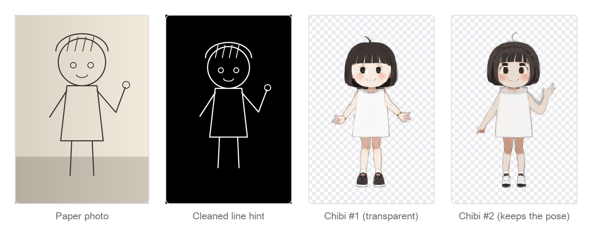
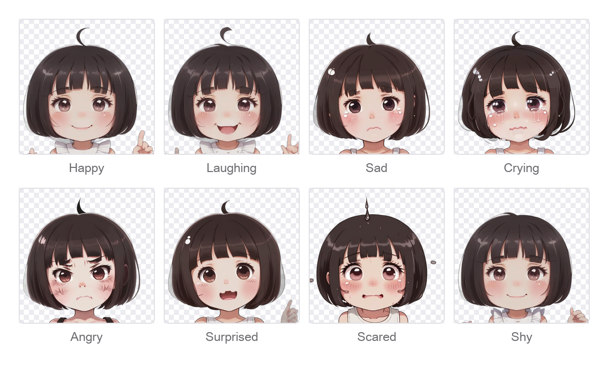
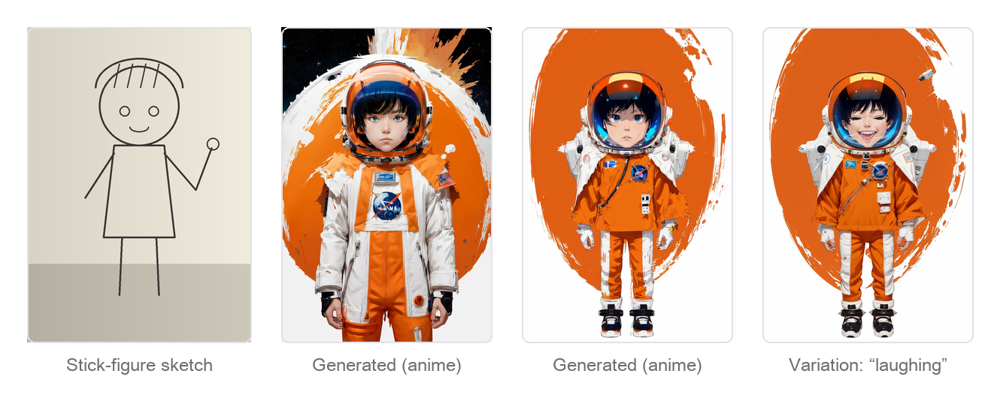
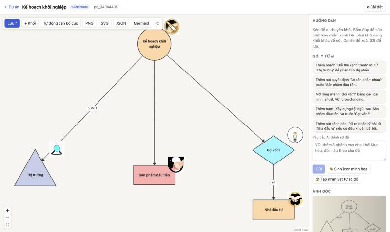
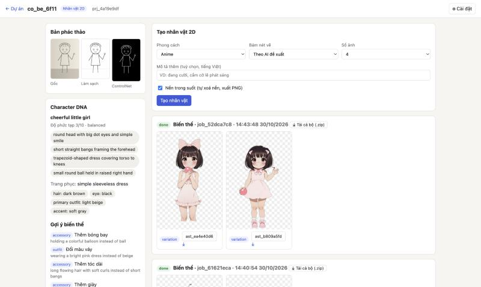
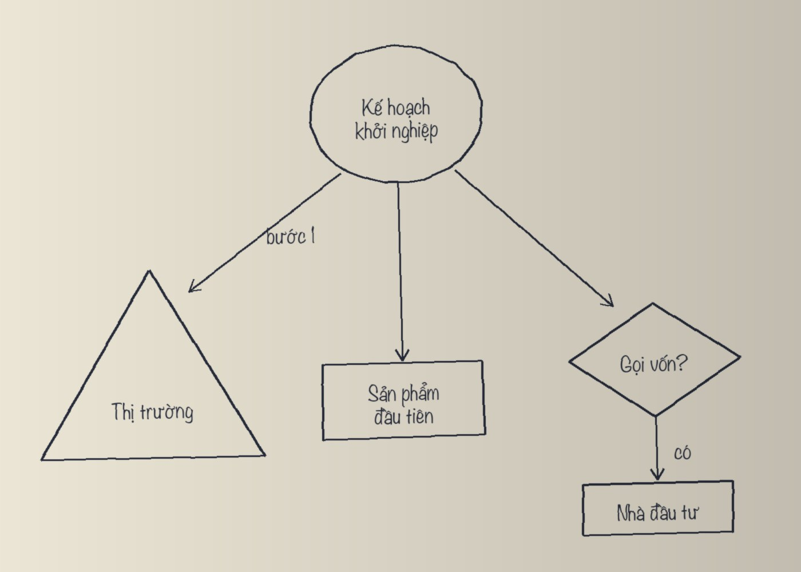
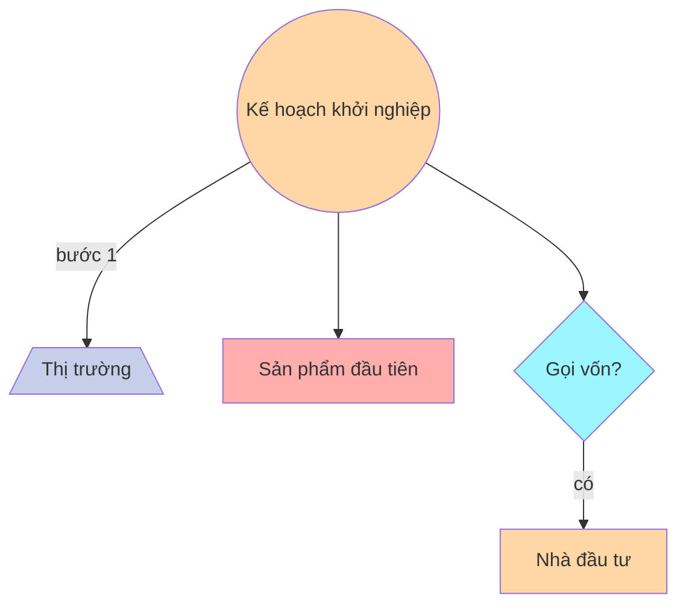
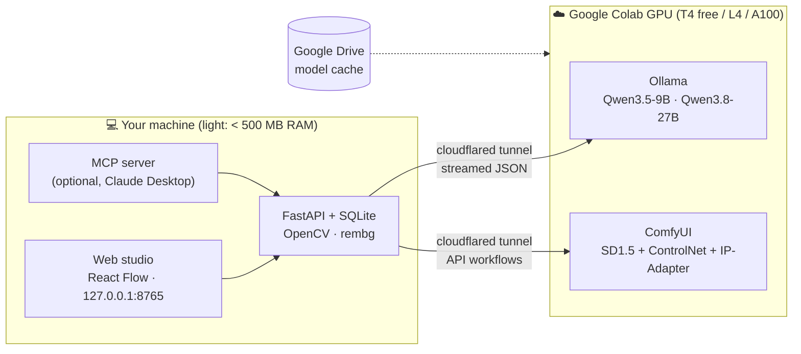

<div align="center">

# ✏️ convert2D-sketch

### Sketch-to-2D Studio — turn a photo of a paper sketch into a 2D character or an editable vector mind map

[](https://www.python.org/)
[](https://docs.astral.sh/uv/)
[](https://github.com/comfyanonymous/ComfyUI)
[](https://ollama.com/)
[](https://modelcontextprotocol.io/)
[](https://colab.research.google.com/github/Leviathan3311/convert2D-sketch/blob/main/colab/comfyui_worker.ipynb)



</div>

**convert2D-sketch** routes every photo of a hand-drawn page to the right engine:

- **Character sketches** become finished 2D characters: transparent PNG output, a locked identity ("Character DNA"), variations, and a one-click **expression sticker pack**.
- **Mind maps and flowcharts** (circles, triangles, boxes, arrows, handwritten Vietnamese text) become a **vector diagram** you can edit, auto-layout and export. The text stays crisp and correct because it is never rasterised.
- **Concept mind maps** ("hair: red, outfit: torn cape, weapon: glowing wrench…") are merged into a single character design.

It runs on a laptop plus a **free Google Colab GPU**. The heavy models live on Colab; your Mac only runs a small web studio.

---

## ✨ Highlights

| | |
|---|---|
| 🧭 **Vision router** | A VLM classifies the photo, reads handwritten Vietnamese (with a diacritics proof-reading pass), and returns strict JSON validated by Pydantic. |
| 🎨 **Sketch → character** | Paper-shadow removal (OpenCV) → line-art ControlNet → SD 1.5 + hi-res pass → automatic background removal. |
| 😀 **Expression pack** | 12 preset emotions plus your own. Every emotion shares one seed and source latent, and an **IP-Adapter PLUS FACE** face lock keeps the identity. |
| 🔒 **Face lock** | Adjustable strength. Falls back gracefully if the custom node is missing on Colab. |
| 🗺️ **Mind-map editor** | React Flow canvas with real triangles, diamonds and clouds. Drag, edit text, connect, auto-layout (dagre), export PNG / SVG / JSON / Mermaid. |
| 💬 **Talk to it in Vietnamese** | Click the AI's suggestion chips or type a request: "add 3 sub-branches", "make her hold a red balloon". |
| 🖼️ **Illustrated sketchnotes** | AI-written icon prompts are rendered on Colab and pinned to each branch. |
| 🔌 **Two front doors** | Web-only (self-hosted Qwen), or **Claude Desktop over MCP** (your Claude Pro plan as the brain, no API key). Both share one SQLite store. |

## 🖼️ Gallery

<table>
<tr><td colspan="2" align="center"><b>Expression pack, face locked with IP-Adapter</b> — 8 emotions from one approved image</td></tr>
<tr><td colspan="2"></td></tr>
<tr><td colspan="2" align="center"><b>Stick figure → character → variation</b></td></tr>
<tr><td colspan="2"></td></tr>
<tr>
<td width="50%" align="center"><b>Mind-map editor</b> (vector, editable, AI suggestions)<br></td>
<td width="50%" align="center"><b>Character studio</b> (generate, select, vary, export)<br></td>
</tr>
</table>

<details>
<summary><b>Mind map: the input photo and the Mermaid code the studio produced from it</b></summary>




</details>

## 🏗️ How it works



**Pipeline for one photo**

1. **Pre-process (Mac):** EXIF fix → divide out the paper shadow → binarise into a white-on-black line hint, letterboxed to the generation size.
2. **Understand (VLM):** classify → extract a `MindMapGraphStructure` *or* a `CharacterDNAProfile` → proof-read Vietnamese diacritics. A fix is accepted only when the base letters are unchanged, so the model can never rewrite your words.
3. **Render:**
   - Mind maps are drawn as vectors in the browser and use no GPU.
   - Characters go to ComfyUI as API-format workflows built **only from core nodes** (plus IP-Adapter for face lock), so nothing on Colab needs to be compiled.
4. **Post-process (Mac):** download → `rembg isnet-anime` cut-out → store assets and versions in SQLite.

## 🚀 Quick start

### 1. Start the GPU worker on Colab

[](https://colab.research.google.com/github/Leviathan3311/convert2D-sketch/blob/main/colab/comfyui_worker.ipynb)

1. Open the notebook, then select **Runtime → Change runtime type → T4 GPU** (or L4 / A100).
2. Click **Runtime → Run all**.
   - The first run downloads about 6.3 GB of image models plus the LLM into Google Drive.
   - Later sessions start in about 2–3 minutes.
3. The last cell prints two URLs:

```text
COMFY_URL = https://xxxx.trycloudflare.com
LLM_URL   = https://yyyy.trycloudflare.com (qwen3.5:9b-q4_K_M)
```

The LLM is picked from available VRAM: **T4 → `qwen3.5:9b`**, **≥ 40 GB → `qwen3.8:27b`**. The smallest Qwen 3.8 is 27B, which does not fit on a T4.

### 2. Run the studio locally

```bash
git clone https://github.com/Leviathan3311/convert2D-sketch.git
cd convert2D-sketch
uv sync
uv run studio-web          # → http://127.0.0.1:8765
```

### 3. Connect and create

1. Click **⚙︎ Cài đặt** (Settings; the UI is in Vietnamese), paste `COMFY_URL` and `LLM_URL`, then click **Lưu & kiểm tra** (Save & check). You should see ✅ T4, 🔒 face lock, and the Qwen model.
2. **Drag a photo** of your drawing onto the home page. You can try the files in [`examples/`](examples/).
3. Wait about 30–50 s for the AI to read it. If it guesses the type wrong, force it with one click.

## 🧑‍🎨 Using the studio

<details open>
<summary><b>Characters</b></summary>

- **Generate:** pick a style (anime · chibi · flat vector · cartoon · watercolor), a sketch fidelity (strict · balanced · creative), and how many images. Add an optional description in Vietnamese. **Transparent background** is on by default.
- **Select an image you like**, then:
  - **Variation:** click an AI suggestion chip, or type a request in Vietnamese. The LLM turns it into a weighted SD prompt. Colours are bound to their own objects to limit colour bleed.
  - **Expression pack:** tick emotions (or type your own), choose *portrait (sticker)* or *full body*, set the **face-lock** strength, then **Download all (.zip)**.
  - **Remove background:** turns any older opaque image into a transparent sticker.
</details>

<details open>
<summary><b>Mind maps & flowcharts</b></summary>

- Edit directly on the canvas:
  - Drag nodes, double-click to edit text, change shape and colour.
  - Drag the blue handle to connect nodes; Delete removes the selection.
  - ⌘S saves. Every save creates a new version.
- **AI suggestions:** click one to apply it, or type an instruction. The server keeps your positions and arrow labels, and places new nodes without overlaps.
- **🎨 Illustrated icons:** the AI writes a concrete prompt for each node, Colab draws 512 px icons, and they are pinned to the nodes.
- **🧑‍🎨 Character from this map:** merges every branch into a Character DNA, then switches to the character tab.
- **Export:** PNG · SVG · JSON · Mermaid.
</details>

## 🤖 Optional: Claude Desktop as the brain (MCP)

Prefer Claude to read your sketches? Register the MCP server. It uses your Claude Pro plan and needs no API key.

```json
// ~/Library/Application Support/Claude/claude_desktop_config.json
{
  "mcpServers": {
    "sketch-studio": {
      "command": "/absolute/path/to/uv",
      "args": ["run", "--directory", "/absolute/path/to/convert2D-sketch", "studio-mcp"]
    }
  }
}
```

Quit Claude Desktop (⌘Q) and reopen it. Then put a photo in `inbox/` and say *"open sketch.jpg in sketch studio and make a chibi character"*.

| Tool | What it does |
|---|---|
| `studio_status`, `set_comfy_url` | Check / set the Colab ComfyUI tunnel |
| `list_sketches`, `open_sketch` | Clean a photo from `inbox/` and return it for Claude to look at |
| `submit_analysis` | VLM router: validated `UniversalSketchAnalysisResponse` |
| `get_mindmap` | Latest graph, including edits made in the web UI |
| `generate_character`, `generate_variation`, `generate_expressions` | ComfyUI jobs (face lock: `face_lock` 0–1) |
| `generate_mindmap_icons`, `get_job`, `remove_background` | Icons, polling with thumbnails, stickers |

## ⚙️ Configuration

| Variable | Default | Purpose |
|---|---|---|
| `STUDIO_HOME` | repo root | Where `inbox/` and `storage/` (SQLite + images) live |
| `STUDIO_WEB_PORT` | `8765` | Web studio port |
| `COMFY_URL`, `LLM_URL` | — | Initial values. Usually set in **⚙︎ Cài đặt** (Settings), because tunnel URLs change every session |
| `LLM_MODEL` | first Ollama model | Force a model, e.g. `qwen3.8:27b-q4_K_M` |
| `STUDIO_CHECKPOINT` | `DreamShaper_8_pruned.safetensors` | Any SD 1.5 checkpoint present on Colab |

Colab notebook switches: `USE_DRIVE` (cache models on Drive), `ENABLE_LLM`, and `LLM_MODEL` (`auto` / explicit tag).

## 🧠 Models

| Role | Model | Size |
|---|---|---|
| Image generation | DreamShaper 8 (SD 1.5) | 2.1 GB |
| Sketch control | ControlNet v1.1 lineart / scribble (fp16) | 2 × 0.7 GB |
| Face lock | IP-Adapter PLUS FACE SD1.5 + CLIP ViT-H/14 | 0.1 + 2.5 GB |
| Vision LLM | Qwen3.5-9B (T4) · Qwen3.8-27B (≥ 40 GB) via Ollama | 6.6 / 18 GB |
| Background removal | rembg `isnet-anime` (runs on the Mac CPU) | 0.17 GB |

## ⏱️ Measured performance (Colab T4, Qwen3.5-9B sharing the GPU with ComfyUI)

| Action | Wall time | GPU time |
|---|---|---|
| Read a 5-node handwritten mind map (+ diacritics proof-read) | ~44–51 s | — |
| Analyse a character sketch | ~32 s | — |
| 2 characters, 768×1152, hi-res, transparent | ~68 s | ~54 s |
| 4 face-locked expressions (portrait) | ~66 s | ~38 s |
| 1 variation from a Vietnamese request | ~75 s | ~53 s |
| AI edit of a mind map | ~60 s | — |

The first job of a session is slower because models load from Drive.

## 🧪 Development

```bash
uv run pytest -q
```

The suite runs the whole pipeline against an in-process **mock ComfyUI + Ollama** ([`tests/mock_comfy.py`](tests/mock_comfy.py)), which:
- validates every workflow against the real core-node signatures from `ComfyUI/nodes.py` and `ComfyUI_IPAdapter_plus`;
- covers analysis, the diacritics guard, graph merging, colour binding, face lock and zip export.

```
src/sketch_studio/
├── web.py          FastAPI app + REST API for the web studio
├── static/         Single-file React + React Flow UI (no build step)
├── service.py      Orchestration: jobs, collection, cut-outs, expressions
├── comfy.py        ComfyUI client + workflow builders (core nodes, IP-Adapter, BREAK)
├── llm.py          Ollama client (streamed), prompts, proof-reading, graph merge
├── mcp_server.py   Claude Desktop tools (MCP)
├── preprocess.py   Paper cleanup, line hints, bust/face crops
├── schemas.py      Pydantic schemas (BRD §4) + Mermaid export
└── db.py           SQLite store
colab/              GPU worker notebook (ComfyUI + Ollama + cloudflared)
examples/           Sample sketches to try
docs/               Architecture BRD, Vietnamese guide, README assets
```

## 🛠️ Engineering notes

- **Tunnel timeouts:** trycloudflare drops responses that are silent for about 100 s (HTTP 524). LLM calls are streamed and serialised, so long generations never time out.
- **Small-model guardrails:**
  - The server owns positions, icons and arrow labels when the LLM revises a graph.
  - Hex colours are mapped to colour words.
  - Expression words are stripped from identity traits.
- **Colour bleed:** each coloured object gets its own `ConditioningConcat` chunk (the equivalent of A1111's BREAK) plus cross-colour negatives.
- **Expressions:** the emotion is placed first and up-weighted; eyebrow keywords are avoided (they produced thick brows over the bangs); IP-Adapter is released at 60 % of the steps so the face can actually change.

## 🗺️ Roadmap & known limitations

- [ ] Mask-based **inpainting** to recolour a single object exactly (SD 1.5 still bleeds colours somewhat)
- [ ] Per-character **LoRA** training for an even stronger identity lock
- [ ] SDXL / Flux pipeline on larger GPUs
- [ ] Auth-protected tunnels (e.g. Cloudflare Access) instead of public quick tunnels
- [ ] Multi-user backend (Postgres, object storage, credits), as in the [BRD](brd_system_architecture_ai_sketch_to_character_studio_v2.md)

> [!WARNING]
> `trycloudflare.com` links are public and unauthenticated. Don't share them, and stop the Colab runtime when you're done. Colab's free tier may restrict Stable Diffusion UIs; Colab Pro or a RunPod / Modal worker only needs a different `COMFY_URL`.

## 📚 Documentation

- [Architecture & product spec (BRD v2.2)](brd_system_architecture_ai_sketch_to_character_studio_v2.md)
- [Hướng dẫn tiếng Việt (Vietnamese guide)](docs/README.vi.md)

## 📄 License

No license has been chosen yet; all rights reserved by the author until one is added.

Third-party models keep their own licenses (Stable Diffusion / DreamShaper, ControlNet, IP-Adapter, Qwen, rembg).
